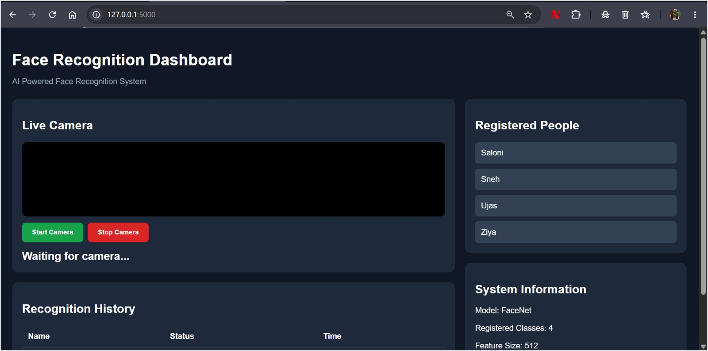

# Real-Time Face Recognition System using FaceNet

A real-time facial recognition application developed using Python, pretrained FaceNet, OpenCV and Flask. The system identifies registered individuals through a webcam using facial embeddings and cosine similarity.


## Dashboard Preview



## 1. Project Overview

This project implements a real-time face recognition system using a pretrained FaceNet model. It extracts facial features and converts detected faces into 512-dimensional numerical embeddings.

The extracted embeddings are compared with previously stored embeddings using cosine similarity to identify registered individuals.

A Flask-based web dashboard provides a user interface for live webcam recognition, registered-user display and recognition history.

## 2. Key Features

- Real-time face detection and recognition.
- Pretrained FaceNet for facial feature extraction.
- 512-dimensional facial embeddings.
- Cosine similarity-based identity matching.
- Threshold-based unknown-person classification.
- Live webcam integration using OpenCV.
- Flask-based interactive dashboard.
- Registered-person display.
- Recognition history with timestamps.
- Handling of no-face and multiple-face detection.

## 3. Technologies Used

| Technology | Purpose |
|---|---|
| Python | Main programming language |
| FaceNet | Facial feature extraction |
| OpenCV | Image processing and webcam access |
| NumPy | Numerical operations |
| Scikit-learn | Cosine similarity in standalone scripts |
| Flask | Backend web framework |
| Flask-CORS | Cross-origin resource sharing |
| HTML and CSS | Dashboard interface |

## 4. Model Architecture and Approach

The project uses a pretrained FaceNet model to generate facial embeddings.

**Implementation details:**

- Model: Pretrained FaceNet
- Embedding dimensions: 512
- Face detection and feature extraction: FaceNet
- Comparison technique: Cosine similarity
- Recognition threshold: 0.70 (provisional)

The pretrained model is used without training the FaceNet network from scratch.

## 5. System Workflow

1. Collect facial images of registered individuals.
2. Organize images into training, validation and test folders.
3. Apply data augmentation to training images.
4. Load the pretrained FaceNet model.
5. Detect faces and extract facial embeddings.
6. Store embeddings with corresponding identity labels.
7. Capture live webcam frames.
8. Extract an embedding from the detected face.
9. Compare the live embedding with stored embeddings using cosine similarity.
10. Identify the closest matching person if the similarity meets the threshold; otherwise, classify the face as unrecognized.
11. Display the result on the Flask dashboard.

## 6. Model Evaluation

The implementation was evaluated on a held-out test dataset containing images of four registered identities.

| Evaluation Metric | Result |
|---|---:|
| Total test images evaluated | 18 |
| Correct predictions | 18 |
| Incorrect predictions | 0 |
| Observed test accuracy | 100% |
| Skipped images | 1 |

All four registered identities achieved precision, recall and F1-scores of 1.00 in this evaluation.

**Evaluation limitation:** These results are preliminary and based on a small test dataset. They do not establish general real-world accuracy. Unknown-person rejection and threshold performance require separate validation using images of people not included in the registered identities.

## 7. Project Structure

```text
Face-Recognition-Using-FaceNet/
│
├── app.py
├── generate_embeddings.py
├── recognize_face.py
├── webcam_recognition.py
├── requirements.txt
├── .gitignore
├── README.md
├── face-recognition-dashboard.jpeg
│
└── templates/
    └── index.html
```

**Note:** The personal face dataset and generated embeddings are excluded from this public repository for privacy. They must be prepared locally before running the application.

## 8. Installation and Setup

### Prerequisites

- Python 3.10
- Webcam
- Internet connection for installing dependencies and downloading pretrained model weights when required.

### Step 1: Clone the repository

```bash
git clone https://github.com/ziyapatel0169/Face-Recognization-Dashboard.git
```

```bash
cd Face-Recognization-Dashboard
```

### Step 2: Install dependencies

```bash
pip install -r requirements.txt
```

### Step 3: Prepare the dataset

Create the following local directory structure:

```text
data/
└── train/
    ├── Saloni/
    ├── Sneh/
    ├── Ujas/
    └── Ziya/
```

Place the corresponding training images inside each person's folder. Use images only with the individuals' permission.

### Step 4: Generate facial embeddings

Run:

```bash
python generate_embeddings.py
```

This generates:

```text
model_data/
├── embeddings.npy
└── labels.npy
```

### Step 5: Run the Flask application

```bash
python app.py
```

### Step 6: Open the dashboard

Visit:

http://127.0.0.1:5000

Allow webcam access to start real-time recognition.

## 9. Privacy Considerations

Facial images and facial embeddings are sensitive biometric data.

For this reason:
- Personal facial datasets are not included in this public repository.
- Generated embeddings and identity labels are excluded.
- Use facial images only with the individuals' informed permission.
- Do not use this project for identification without appropriate consent.

## 10. Future Improvements

- Calibrate the recognition threshold using validation data.
- Evaluate performance on a larger and more diverse dataset.
- Improve recognition under different lighting conditions and facial angles.
- Add secure user registration.
- Introduce persistent recognition history.
- Improve unknown-person detection and evaluation.

## 11. Project Team
- Saloni Malviya
- Ujas Patel
- Sneh Parmar

**Team 11 — B.Tech Computer Science and Engineering**

**Lead Developer**
- Ziya Patel — FaceNet integration, recognition pipeline, Python implementation, Flask backend and dashboard development.

**Group Members**


**Institution:** Karnavati University, Unitedworld Institute of Technology.

---

**Developed as an academic mini-project using Deep Learning and Computer Vision.**
